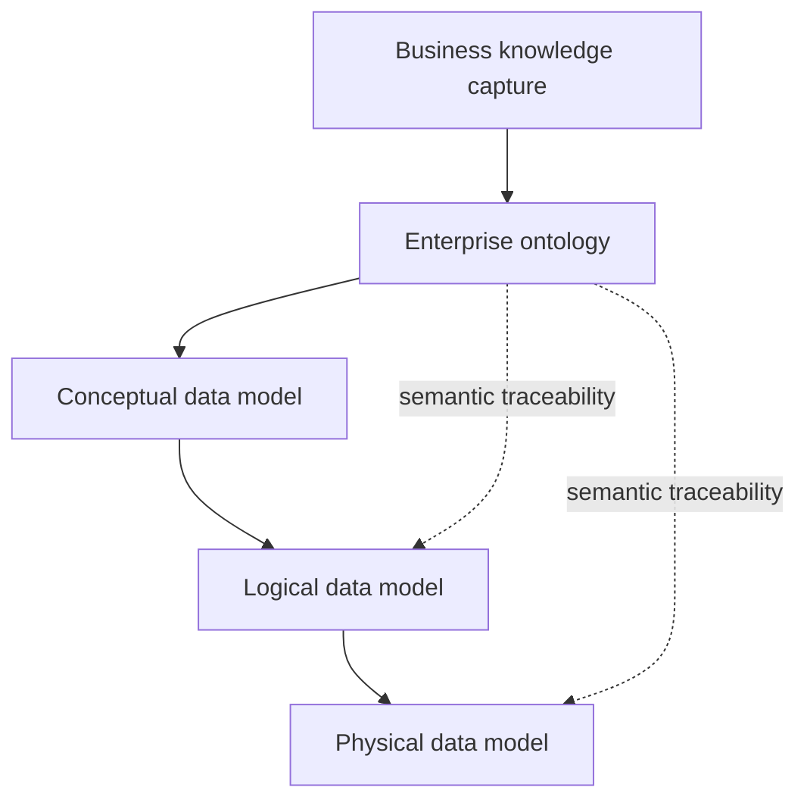

# From enterprise ontology to implementation models

## Layers and responsibilities

### Enterprise ontology
Describes **what things mean**: business concepts, relationships, constraints and vocabulary. It is independent of any storage technology.

### Conceptual data model
Selects relevant business entities and high-level relationships for a particular information scope. It is a projection of the ontology, not necessarily a one-to-one translation.

### Logical data model
Defines implementable structures: attributes, identifiers, cardinalities, normalization, reference relationships and integrity constraints, without committing to a specific database engine.

### Physical data model
Defines tables, columns, indexes, partitions, graph labels/edges or other storage-specific representations, depending on technology and performance requirements.

## Illustrative mapping
| Semantic layer | Example |
| --- | --- |
| Ontology | Company has a Fiscal Calendar; Reporting Period is interpreted within that calendar |
| Conceptual | Company — Fiscal Calendar — Reporting Period |
| Logical | Company(company_id); FiscalCalendar(calendar_id, company_id); ReportingPeriod(period_id, calendar_id, start_date, end_date) |
| Physical | SQL tables, keys, indexes and data types, or equivalent platform-specific structures |

The example is illustrative, not a prescribed schema. The exact keys and relationships depend on domain requirements.

## Important caveats
- Not every ontology concept should become a table.
- Some relationships are derived, computed or represented as rules.
- A single ontology can support several bounded-context models and data products.
- Physical schemas may denormalize without changing the underlying business semantics.
- Maintain mappings and lineage rather than assuming automated lossless transformation.

## Data Mesh implications
Domain teams may own their logical and physical data models while sharing governed definitions for cross-domain concepts. Reference concepts and canonical identifiers need clear ownership. Semantic interoperability does not require a single enterprise-wide database schema.

## Suggested deliverables
- Concept catalogue with definitions, examples and owners
- Concept/relationship diagram and business rules
- Concept-to-logical mapping table
- Logical model and API/data-contract examples
- Physical design and explicit design decisions
